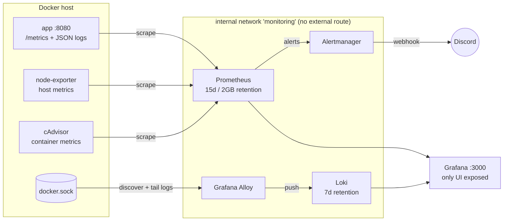
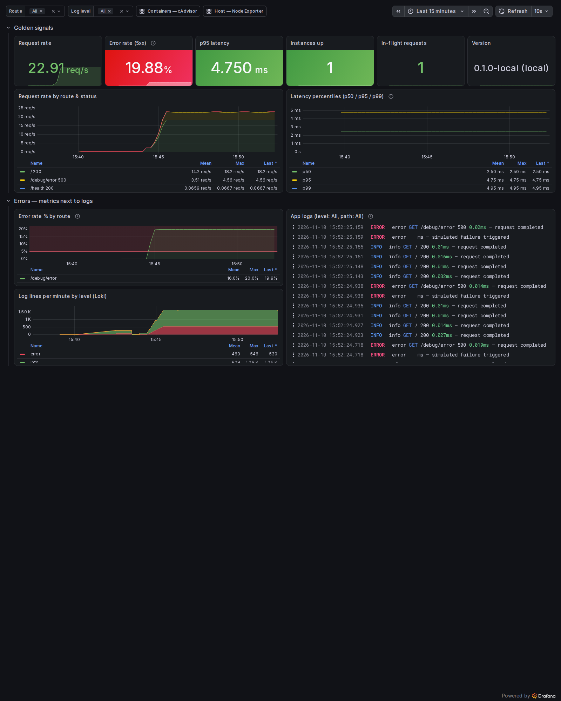
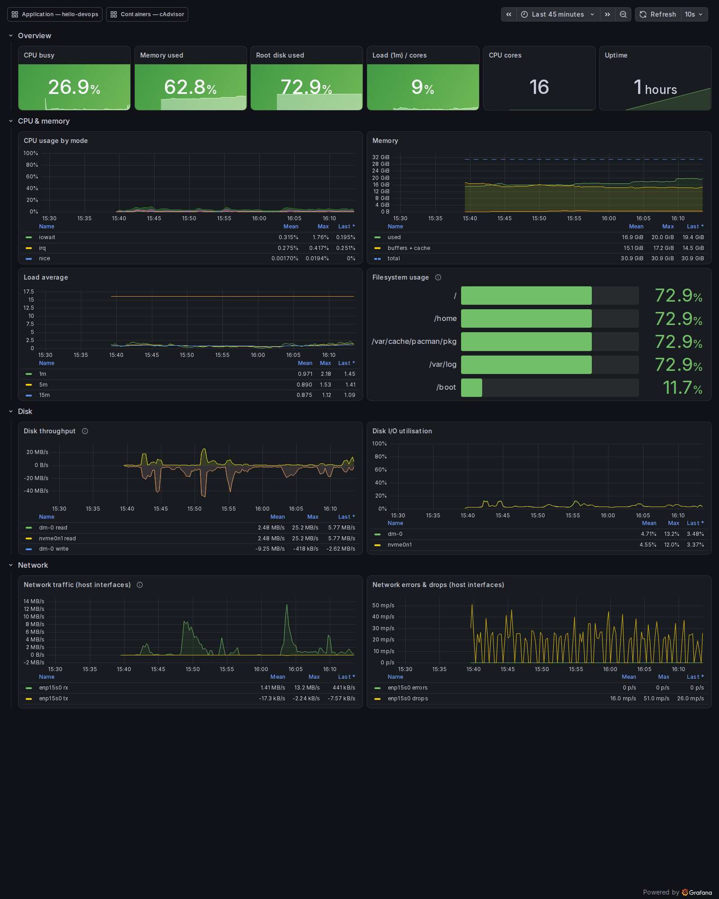
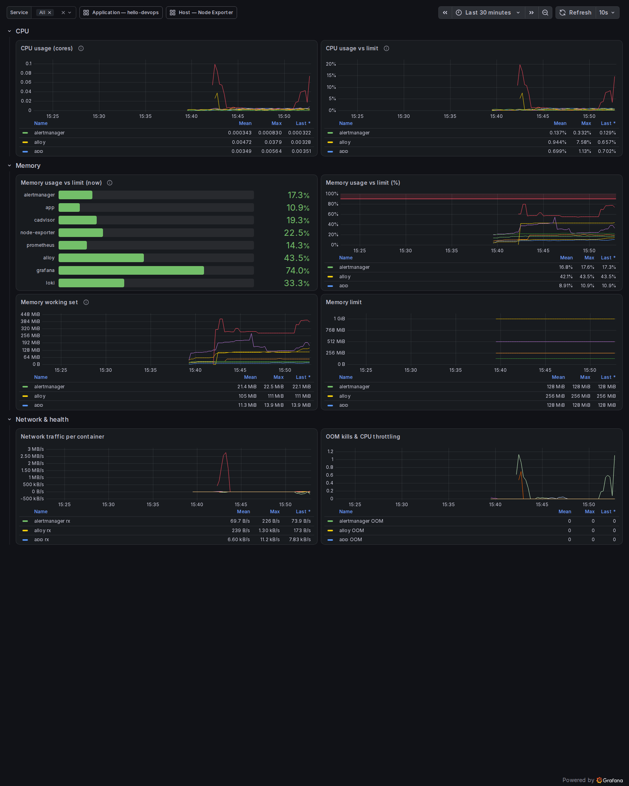
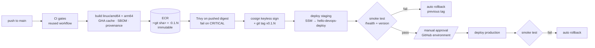
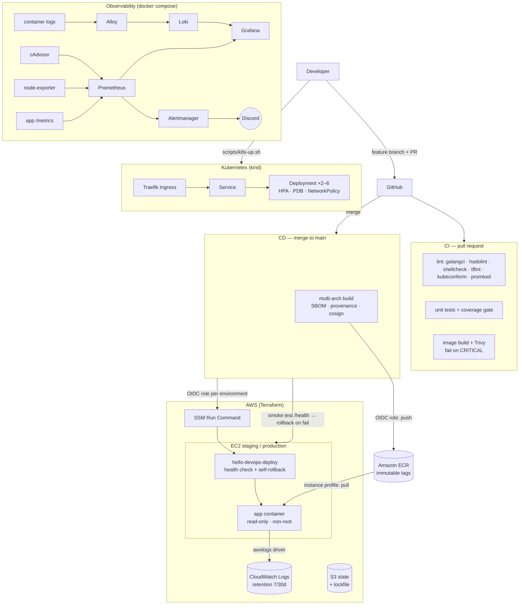

# hello-devops

A small Go web service taken from source to a production-style, observable and securely deployed state:
distroless container → CI with security gates → multi-arch images in ECR → EC2 (Terraform) with
automatic rollback → Kubernetes (kind) → Prometheus / Loki / Alloy / Grafana observability → a
production health-check script.

| | |
|---|---|
| **App** | Go 1.27, `net/http` + `log/slog` + `prometheus/client_golang`, 100 % coverage on the HTTP layer |
| **Image** | distroless `static-debian13:nonroot`, **~5 MB compressed / ~12 MB uncompressed**, 0 known CVEs (Trivy) |
| **CI/CD** | GitHub Actions — lint, test, coverage gate, hadolint, shellcheck, IaC validation, Trivy (fails on CRITICAL), multi-arch build, cosign, SSM deploy with smoke test + rollback |
| **IaC** | Terraform: bootstrap (state bucket, ECR, GitHub OIDC) + reusable `app_host` module + one env config for staging/production |
| **Kubernetes** | Kustomize on kind, Traefik ingress, HPA, PDB, NetworkPolicy, restricted Pod Security |
| **Observability** | Prometheus, Alertmanager, Loki, Grafana Alloy, Node Exporter, cAdvisor, Grafana — all provisioned from files |

---

## Contents

1. [Repository layout](#repository-layout)
2. [Quick start (local)](#quick-start-local)
3. [The application](#the-application)
4. [Running the tests and linters](#running-the-tests-and-linters)
5. [Observability stack](#observability-stack)
6. [Kubernetes deployment](#kubernetes-deployment)
7. [Terraform (AWS)](#terraform-aws)
8. [CI/CD pipeline](#cicd-pipeline)
9. [Linux health script](#linux-health-script)
10. [Architecture](#architecture)
11. [Design decisions](#design-decisions)
12. [Deployment & rollback strategy](#deployment--rollback-strategy)
13. [Security considerations](#security-considerations)
14. [AWS cost estimate](#aws-cost-estimate)
15. [Verification status](#verification-status)
16. [What I would improve with more time](#what-i-would-improve-with-more-time)
17. [Use of AI tools](#use-of-ai-tools)

---

## Repository layout

```
app/                         Go service (cmd/server, internal/config, internal/server) + tests
Dockerfile, .dockerignore    multi-stage distroless build
docker-compose.yml           app (always) + observability stack (profile "monitoring")
monitoring/
  prometheus/                scrape config, alert rules, promtool rule tests
  alertmanager/              routing to Discord (webhook injected at runtime)
  loki/                      single-binary Loki, 7-day retention
  alloy/                     Docker log discovery, JSON parsing, labels
  grafana/                   provisioned data sources + 3 dashboards (JSON)
k8s/
  base/                      Deployment, Service, Ingress, ConfigMap, HPA, PDB, NetworkPolicy, ...
  overlays/kind/             image tag + env overrides for the local cluster
  kind/                      kind cluster config + Traefik Helm values
terraform/
  bootstrap/                 S3 state bucket, ECR repo, GitHub OIDC provider + push role (once per account)
  modules/app_host/          EC2 + SG + IAM instance profile + CloudWatch + user data
  envs/                      root config for staging / production (tfvars + backend files)
.github/workflows/           ci.yml (PRs) and cd.yml (main → ECR → staging → production)
scripts/
  system_health.sh           host health check (+ systemd/ unit, timer and cron entry)
  ci-deploy.sh               SSM deploy + external smoke test + rollback (used by CD)
  k8s-up.sh                  one-shot kind cluster + deploy
docs/                        screenshots and captured command output
Makefile                     make test | lint | build | scan | up | k8s | health
```

---

## Quick start (local)

**Prerequisites:** Docker Engine 24+ with Compose v2 (Linux or Docker Desktop), `make`, `curl`, `openssl`.
For Kubernetes also `kind`, `kubectl` and `helm`. Nothing else: Go, linters and scanners all run in containers.

```bash
git clone https://github.com/Rajvira10/hello-devops.git && cd hello-devops

# 1. Create .env (git-ignored). `make up` does this for you and generates a random Grafana password.
cp .env.example .env            # then edit GRAFANA_ADMIN_PASSWORD

# 2. Start the app and the full observability stack
docker compose up -d --build    # or: make up

docker compose ps               # all services should be running / healthy within ~30s
```

| What | URL | Notes |
|---|---|---|
| App | <http://localhost:8080/> | `/health`, `/metrics` |
| Grafana | <http://localhost:3000/> | login with `GRAFANA_ADMIN_USER` / `GRAFANA_ADMIN_PASSWORD` from `.env` |

The Grafana home page is the **Application** dashboard. All three dashboards are in the **hello-devops** folder
(*Dashboards → hello-devops*), and each has links to the others in its top bar.

To run **only the app** (Step 1), leave `COMPOSE_PROFILES` unset: `COMPOSE_PROFILES= docker compose up -d app`.

**Generating some traffic and errors** (useful to see dashboards and alerts move):

```bash
# set ADMIN_TOKEN=demo-token in .env first, then `docker compose up -d app`
for i in $(seq 1 2000); do
  curl -s -o /dev/null localhost:8080/
  (( i % 5 == 0 )) && curl -s -o /dev/null -H 'X-Admin-Token: demo-token' localhost:8080/debug/error
  sleep 0.05
done
```

Stop with `docker compose down` (add `-v` to delete the stored metrics/logs).

---

## The application

| Endpoint | Description |
|---|---|
| `GET /` | `{"message":"Hello from DevOps Task!","status":"running","version":"<version>"}` |
| `GET /health` | `200 {"status":"ok"}`; returns **503** while draining after SIGTERM so it doubles as a readiness signal |
| `GET /metrics` | Prometheus metrics (below) |
| `GET /debug/error` | Returns 500 on purpose, to demo error alerts. **Disabled (404) unless `ADMIN_TOKEN` is set**, and needs the `X-Admin-Token` header |

**Metrics:** `http_requests_total{method,route,status}`, `http_request_errors_total{method,route}` (5xx),
`http_request_duration_seconds{method,route}` histogram (5 ms – 5 s buckets), `http_requests_in_flight`,
`app_build_info{version,env}`, plus Go runtime and process metrics. `route` is the **matched route pattern**,
and unknown URLs collapse to `unmatched`, so a scanner hitting random paths cannot blow up cardinality.
A unit test checks this.

**Configuration** (environment variables only):

| Variable | Default | Purpose |
|---|---|---|
| `PORT` | `8080` | listen port |
| `LOG_LEVEL` | `info` | `debug` / `info` / `warn` / `error` |
| `APP_ENV` | `development` | environment name, added to every log line and to `app_build_info` |
| `SHUTDOWN_DELAY` | `0s` | after SIGTERM, keep serving (with `/health`=503) this long before draining |
| `SHUTDOWN_TIMEOUT` | `15s` | max time to drain in-flight requests |
| `ADMIN_TOKEN` | *(empty)* | secret enabling `/debug/error` |

The version is baked in at build time (`-ldflags -X main.version=…`), so the image tag and the reported version
always match. CI smoke tests rely on this.

**Logs** are one JSON object per line on stdout:

```json
{"time":"2026-11-10T15:42:31.03Z","level":"ERROR","msg":"request completed","service":"hello-devops","env":"local","version":"0.1.0-local","method":"GET","path":"/debug/error","url":"/debug/error","status":500,"duration_ms":0.014,"remote_addr":"172.19.0.1:34384","user_agent":"curl/8.23.0"}
```

`/health` and `/metrics` requests are logged at `debug` so probes and scrapes don't flood the logs.

**Graceful shutdown:** on SIGTERM the server marks itself not-ready, waits `SHUTDOWN_DELAY`, then calls
`http.Server.Shutdown` to drain connections, and exits 0. This is verified in CI (`docker stop` must exit 0)
and on Kubernetes (zero failed requests during rollouts, see below).

### Container image

- **Multi-stage**. The builder (`golang:1.27.3-alpine3.24`, pinned by digest) cross-compiles with
  `--platform=$BUILDPLATFORM` and `TARGETARCH`, so building arm64 needs no QEMU. BuildKit cache mounts keep
  module and build caches between builds, and `go.mod`/`go.sum` are copied first so dependencies get their own layer.
- **Runtime** is `gcr.io/distroless/static-debian13:nonroot`, pinned by digest. It has no shell or package
  manager and runs as UID 65532. The image is just one 9.9 MB static binary on a ~2 MB base:
  **~5 MB compressed (what you pull), ~12 MB on disk**.
- `HEALTHCHECK` runs `/server healthcheck`, because there's no curl in distroless. OCI labels (version,
  revision, created, source) come from build args. `.dockerignore` is an allow-list.
- Compose runs it with `read_only: true`, `cap_drop: [ALL]`, `no-new-privileges`, CPU/memory limits, log
  rotation and `restart: unless-stopped`.

---

## Running the tests and linters

```bash
make test     # go test -race -cover ./...           (in a golang container)
make lint     # golangci-lint, hadolint, shellcheck, promtool rule unit tests
make scan     # build + Trivy, fails on CRITICAL
```

Without make: `cd app && go test -race -cover ./...` (Go 1.27+).

| Package | Coverage |
|---|---|
| `internal/server` (handlers, middleware, metrics) | 100 % |
| `internal/config` | 94 % |
| `cmd/server` (startup, graceful shutdown, healthcheck subcommand) | 83 % |
| **Total** (CI gate: 80 %) | **93 %** |

The tests cover every endpoint, the 503-while-draining behaviour, metric names/labels, the bounded `route` label,
`/debug/error` auth (404 / 403 / 500), the JSON log format, config parsing and validation, and an end-to-end
start → serve → cancel (SIGTERM) → drain → clean exit of the real server, plus the `healthcheck` subcommand.

**Alert rules have their own unit tests**: `monitoring/prometheus/tests/alerts_test.yml`, run with
`promtool test rules`. They check that each alert fires only after its `for` duration and respects its thresholds,
for example that the low-traffic guard suppresses the error-rate alert and that containers without a limit
never trigger the memory alert.

---

## Observability stack

All seven containers come from `docker-compose.yml` under the `monitoring` profile, which `.env.example` enables.
Every image is pinned by **tag and digest**.



### Metrics collection

- Prometheus scrapes `app:8080/metrics`, `node-exporter:9100`, `cadvisor:8080`, and itself, Loki, Alloy,
  Alertmanager and Grafana. If the monitoring stack breaks, that shows up in Prometheus too (`ScrapeTargetDown`).
- **Retention: `--storage.tsdb.retention.time=15d` and `--storage.tsdb.retention.size=2GB`**, whichever is hit first.
  The size cap stops a laptop disk from filling up.
- cAdvisor runs with a reduced metric set (`--disable_metrics=…`, `--docker_only`) and only keeps the compose
  service/project labels. `veth*` network series are dropped at scrape time. This keeps it cheap.

### Log collection and label strategy

Alloy (`monitoring/alloy/config.alloy`) discovers **all** containers through the Docker API, tails their logs and
pushes them to Loki:

1. `discovery.docker` → `discovery.relabel`: `container`, `service` (compose service), `project`.
2. For `service="app"`, `stage.json` parses the slog line, takes the timestamp from the log itself, and promotes
   fields as follows.
3. For the Grafana-stack services, which log in logfmt, `stage.logfmt` extracts `level`.
4. `level` is normalised to `debug|info|warn|error` (`INFO`, `warning`, `eror`, `lvl=` → one spelling).

| Field | Stored as | Why |
|---|---|---|
| `service`, `container`, `project` | **label** | ~10 values, stable. The main way you select a stream |
| `level` | **label** | 4 values. "Show me errors" is the most common query and should hit the index |
| `path`, `method`, `status` | **structured metadata** | filterable (`{service="app"} \| path="/"`) without creating streams. `path` is already bounded by the app, but `status × path × method` would multiply streams for little gain |
| `url`, `duration_ms`, `user_agent`, `remote_addr` | **log line only** | unbounded. Parse at query time with `\| json` |

Rule of thumb: a label must be **low-cardinality and something you select by**. Everything else is a filter.
This keeps active streams around `services × 4 levels` instead of growing with traffic.

**Loki retention: 7 days** (`limits_config.retention_period: 168h`). It is enforced by the compactor
(`retention_enabled: true`). Without the compactor setting, Loki silently ignores `retention_period`, which is
a common misconfiguration.

### Dashboards (provisioned as code)

Data sources (`provisioning/datasources/datasources.yml`, fixed UIDs) and dashboards (`dashboards/*.json`) load
from the repo at startup. UI edits are disabled (`allowUiUpdates: false`, `editable: false`), so the repo is the
source of truth.

**Application** shows request rate, 5xx error rate, p50/p95/p99 latency, instances up, in-flight requests and
version, with **the error-rate graph and a Loki logs panel side by side**, filterable by route and log level.
Captured during an induced 20 % error spike:



**Host** (Node Exporter) shows CPU by mode, memory, load per core, filesystem usage per mount, disk throughput and
utilisation, and network traffic and errors:



**Containers** (cAdvisor) shows per-container CPU (cores and % of the `cpus` limit), memory working set,
**memory as a % of the configured limit** (bar gauge plus time series), network, OOM kills and CPU throttling:



> **Host network panels come from cAdvisor's root cgroup (`id="/"`), not node-exporter.** node-exporter must stay
> on the internal network (only Grafana may be exposed), so it has its own network namespace and only sees its
> own `eth0`. I checked this: in bridge mode it reported `eth0` and `lo` while the host NIC is `enp15s0`.
> cAdvisor's root-cgroup series do report the real host interfaces (`enp15s0`, bridges), so the panels use those. On a real server node-exporter
> would run as a systemd service or with `network_mode: host`, where this doesn't apply.

### Alerting rules

Defined in `monitoring/prometheus/rules/alerts.yml`, routed by Alertmanager to Discord, and unit-tested with promtool.

| Alert | Condition | `for` | Severity | Reasoning |
|---|---|---|---|---|
| **AppInstanceDown** | `up{job="app"} == 0` | 1m | critical | 4 failed scrapes in a row at a 15s interval. Long enough to ignore one dropped scrape or a container restart, short enough to page within ~1–2 minutes of a real outage. |
| **AppHighErrorRate** | 5xx / all requests > **5 %** over 5m, **and** > 0.1 req/s | 5m | critical | 5 % means 1 in 20 users failing, which is clearly user-visible and well above normal noise for this service. The traffic guard stops one failed request at 3 a.m. (1/1 = 100 %) from paging anyone. 5m of `for` on top of a 5m rate window means a sustained problem, not one bad deploy step. |
| **AppHighLatencyP95** | p95 > **500 ms** (excluding `/metrics`) | 10m | warning | Normal p95 is ~5 ms, so 500 ms is a 100× regression without being so tight that GC pauses trip it. It's a warning: slow isn't broken. |
| **HostDiskUsageHigh** | filesystem > **80 %** | 15m | warning | The value from the brief. 15m ignores short spikes (log bursts, image pulls) and still leaves hours to act. |
| **HostDiskUsageCritical** | filesystem > **90 %** | 5m | critical | Writes fail soon after this. Inhibits the 80 % warning for the same mountpoint. |
| **HostHighCpuUsage** | CPU > **90 %** | 15m | warning | Only sustained saturation matters. Short CPU bursts are normal. |
| **ContainerMemoryNearLimit** | working set / limit > **90 %** (limit > 0) | 5m | warning | Working set is what the OOM killer acts on. Above 90 % for 5 minutes means the next spike is likely an OOM kill. Containers without a limit are excluded. |
| **ScrapeTargetDown** | any other target `up == 0` | 5m | warning | Blind spots matter, but a monitoring component restarting isn't an emergency. |

Inhibition: `AppInstanceDown` suppresses the error-rate and latency alerts, so one incident produces one page.

**Proof:** with ~20 % errors injected, `AppHighErrorRate` went *pending* at 15:44:42 and *firing* exactly 5
minutes later at 15:49:42, and Alertmanager received it:

```
AppHighErrorRate firing since 2026-11-10T15:44:42Z value=0.1989
AM: AppHighErrorRate active startsAt=2026-11-10T15:49:42.806Z
```

Discord delivery is optional. Put a webhook URL in `DISCORD_WEBHOOK_URL` in `.env`. Alertmanager can't expand
environment variables in its config, so the container writes the URL to a `tmpfs` file at startup and reads it
with `webhook_url_file`. The URL is never stored in the repo or on disk.

### Hygiene and security

- **Grafana credentials** come from `.env`. Compose refuses to start (`${VAR:?}`) if they're missing. Sign-up,
  anonymous access, analytics and update checks are disabled.
- **Network exposure:** only Grafana (and the app, as Step 1 requires) publish ports, and both bind to
  `127.0.0.1` by default (`BIND_ADDR`). Prometheus, Alertmanager, Loki, Alloy, node-exporter and cAdvisor sit on
  the `monitoring` network with `internal: true`: no published ports and no route out.
- **Pinned images:** every image is pinned by `tag@sha256:digest`.
- **Resource limits** on every container, so the Containers dashboard can show usage against a real limit.

**Host access granted to the exporters**, and why:

| Container | Grants | Why it's needed | Mitigation |
|---|---|---|---|
| node-exporter | `/proc` → `/host/proc:ro`, `/sys` → `/host/sys:ro`, `/` → `/rootfs:ro,rslave`, `pid: host` | host CPU, memory, load, filesystems and process counts live in the host's procfs/sysfs; `rslave` keeps later mounts visible; host PID namespace for host-wide process stats | all mounts read-only, `read_only` root FS, `cap_drop: ALL`, `no-new-privileges`, not privileged, no host network |
| cAdvisor | `privileged: true`, `/dev/kmsg`, `/:/rootfs:ro`, `/sys:ro`, `/var/run:ro`, `/var/lib/docker:ro` | reading every container's cgroup v2 stats and OOM events (`/dev/kmsg`) requires privileged mode on cgroup v2 hosts; the Docker dirs map cgroups to container names | read-only mounts, no published port, internal network only. Privileged is the main residual risk: on Kubernetes the kubelet's built-in cAdvisor endpoint replaces this container |
| Alloy | `/var/run/docker.sock:ro` | Docker service discovery and log tailing | `:ro` does **not** make the API read-only: socket access is effectively root on the host. Production alternatives: a socket proxy that allows only `GET /containers`, or reading `/var/lib/docker/containers/*/*.log` files instead |

### Walkthrough: "An error spike appears on the Application dashboard. How do you find the cause?"

1. **Scope it** on the Application dashboard. *Error rate % by route* shows **which route** is failing. In the
   screenshot it's 100 % `/debug/error` while `/` stays clean. *Request rate by route & status* shows whether
   traffic also changed (a traffic surge points to load, flat traffic to a bug or dependency). The *Version* stat
   and the `app_build_info` series show whether the spike lines up with a deploy. Drag-select the start of the
   spike to zoom every panel, including the logs, to that window.
2. **Read the logs next to the metrics.** Set *Log level* = `error` and *Route* to the failing route. The logs
   panel beside the graph now shows only those lines, e.g. `ERROR GET /debug/error 500 — simulated failure triggered`.
   Expand a line to see all fields (url, duration, user agent, remote address, version).
3. **Go wider in Explore (Loki)** if the panel doesn't explain it:
   ```logql
   {service="app", level="error"} | json | line_format "{{.msg}} {{.url}} {{.status}}"
   sum by (path, status) (count_over_time({service="app"} | status=~"5.." [1m]))
   topk(5, sum by (url) (count_over_time({service="app", level="error"} | json [5m])))
   {service=~".+", level="error"}          # did another container fail at the same time?
   ```
4. **Rule out resources** on the Containers dashboard: did the app hit its memory limit (OOM-kill count),
   get CPU-throttled, or restart? Then on the Host dashboard: disk full, CPU saturated, network errors?
5. **Correlate with changes**, such as a new `version` label, a recent CD run, or config changes. If a deploy
   caused it, roll back first (see [rollback](#deployment--rollback-strategy)), then debug.
6. **Confirm the fix**: the error-rate panel returns to 0 and `AppHighErrorRate` resolves, which Alertmanager
   reports as `resolved`.

---

## Kubernetes deployment

Plain Kustomize under `k8s/`, deployed to a local **kind** cluster with 1 control plane and 2 workers.

```bash
scripts/k8s-up.sh          # or: make k8s   — idempotent
curl http://hello-devops.localhost:8088/            # through the Traefik ingress
# or, without the ingress:
kubectl -n hello-devops port-forward svc/hello-devops 8081:80 && curl localhost:8081/
make k8s-down              # delete the cluster
```

`k8s-up.sh` creates the cluster, installs **metrics-server** (HPA needs it; `--kubelet-insecure-tls` is for kind
only) and **Traefik** (Helm, NodePort mapped to `127.0.0.1:8088`), builds the image and `kind load`s it, creates
the Secret, applies `k8s/overlays/kind` and waits for the rollout.

| Manifest | Key points |
|---|---|
| `deployment.yaml` | 2 replicas; `RollingUpdate` with `maxSurge: 1`, `maxUnavailable: 0`; `minReadySeconds: 5`; **startup, readiness and liveness probes on `/health`** with different thresholds (readiness drops a pod after 10s, liveness restarts only after ~30s); requests `50m/32Mi`, limits `250m/64Mi`; `runAsNonRoot` (UID 65532), **`readOnlyRootFilesystem: true`**, `allowPrivilegeEscalation: false`, `capabilities.drop: [ALL]`, `seccompProfile: RuntimeDefault`; topology spread across nodes; no service-account token |
| `service.yaml`, `ingress.yaml` | ClusterIP :80 → `http` port; Ingress `hello-devops.localhost` (class `traefik`) |
| `configmap.yaml` | `APP_ENV`, `LOG_LEVEL`, `PORT`, `SHUTDOWN_DELAY=5s`, `SHUTDOWN_TIMEOUT` |
| `hpa.yaml` | CPU target 70 % of the request, 2–6 replicas; scale up fast (+2 pods / 30s), scale down slowly (5-minute stabilisation window, −1 pod / min) to avoid flapping |
| `pdb.yaml` | `minAvailable: 1`, so node drains can't take out every replica |
| `networkpolicy.yaml` | default-deny in the namespace; allow :8080 only from the `traefik` namespace and same-namespace pods; egress DNS only |
| `namespace.yaml` | enforces the **`restricted` Pod Security Standard**, which the pods pass |

**Secrets:** the Secret `hello-devops-secrets` is deliberately **not in the repo**. `k8s-up.sh` creates it with a
random value (`kubectl create secret generic … --from-literal=ADMIN_TOKEN=$(openssl rand -hex 24)`), and the
Deployment reads it via `envFrom.secretRef`. In a real cluster I'd use **External Secrets Operator** syncing from
AWS Secrets Manager (no secret in Git at all) or **SOPS/Sealed Secrets** if GitOps needs the encrypted value in Git.

### Zero-downtime rolling update and rollback

Two things make it zero-downtime: `maxUnavailable: 0` (capacity never drops) and the app's drain behaviour. On
SIGTERM, `/health` returns 503 and the pod keeps serving for `SHUTDOWN_DELAY=5s`, so the endpoint is removed from
Traefik and kube-proxy before the server stops accepting connections. A load generator sent a request every 50 ms
through the ingress for the whole update **and** rollback: **2,646 requests, 2,646 × HTTP 200, 0 errors.**

```console
$ kubectl -n hello-devops set image deployment/hello-devops app=hello-devops:0.2.0
deployment.apps/hello-devops image updated
$ kubectl -n hello-devops rollout status deployment/hello-devops
Waiting for deployment "hello-devops" rollout to finish: 1 out of 2 new replicas have been updated...
Waiting for deployment "hello-devops" rollout to finish: 1 old replicas are pending termination...
deployment "hello-devops" successfully rolled out
$ kubectl -n hello-devops get pods -l app.kubernetes.io/name=hello-devops
NAME                            READY   STATUS        RESTARTS   AGE
hello-devops-6b77d78bcc-gd97r   1/1     Terminating   0          78s
hello-devops-8fd7bc548-9r9ws    1/1     Running       0          7s
hello-devops-8fd7bc548-xnglm    1/1     Running       0          15s
$ kubectl -n hello-devops rollout history deployment/hello-devops
REVISION  CHANGE-CAUSE
1         <none>
2         release 0.2.0
$ kubectl -n hello-devops rollout undo deployment/hello-devops
deployment.apps/hello-devops rolled back
$ kubectl -n hello-devops rollout status deployment/hello-devops
Waiting for deployment "hello-devops" rollout to finish: 1 out of 2 new replicas have been updated...
Waiting for deployment "hello-devops" rollout to finish: 1 old replicas are pending termination...
deployment "hello-devops" successfully rolled out
$ kubectl -n hello-devops get deployment hello-devops -o jsonpath='{.spec.template.spec.containers[0].image}'
hello-devops:0.1.0

# load generator during update + rollback (curl every 50ms through the ingress)
   2646 200
   2220 "version":"0.1.0"
    426 "version":"0.2.0"
```

The full captured output is in [`docs/k8s-rollout-demo.txt`](docs/k8s-rollout-demo.txt). (A terminating 0.1.0 pod
still answered for a few seconds after `rollout status` returned. That's the drain window doing its job.)

### How this would change on EKS

| Concern | Local (kind) | Production on EKS |
|---|---|---|
| Ingress | Traefik NodePort | **AWS Load Balancer Controller** (ALB via `Ingress`, or Gateway API), ACM certificates, WAF, HTTPS only |
| Secrets | `kubectl create secret` from a script | **External Secrets Operator** + AWS Secrets Manager / SSM, KMS envelope encryption for etcd Secrets |
| AWS access from pods | none | **IRSA or EKS Pod Identity**: an IAM role per ServiceAccount, no node-wide credentials |
| Node scaling | fixed 3 nodes | **Karpenter** (or Cluster Autoscaler) with managed node groups across 3 AZs; HPA scales pods, Karpenter scales nodes |
| Images | `kind load` | ECR with immutable tags; deploy by digest; admission policy (Kyverno) requiring signed images (cosign) and blocking `:latest` |
| Deployments | `kubectl apply -k` | GitOps (Argo CD / Flux) watching an env repo or overlay; Argo Rollouts for canary with automated analysis on the Prometheus error-rate metric |
| Observability | separate compose stack | kube-prometheus-stack (Prometheus Operator, ServiceMonitor for the app), Loki + Alloy DaemonSet, or Amazon Managed Prometheus / Grafana |
| Network | kindnet NetworkPolicy | VPC CNI with network policy enforcement, private subnets, Security Groups for Pods where needed |
| Resilience | — | PDBs (already here), topology spread across AZs, `priorityClassName`, resource quotas / LimitRanges per namespace |

---

## Terraform (AWS)

```
terraform/
  bootstrap/          once per account, local state → can be migrated into the bucket it creates
  modules/app_host/   EC2 + SG + IAM + CloudWatch + user data (reusable)
  envs/               root module; staging.tfvars / production.tfvars; backend/*.s3.tfbackend
```

**What gets created**

| Stack | Resources |
|---|---|
| bootstrap | S3 state bucket (versioned, SSE-KMS, public access blocked, TLS-only policy, old versions expire after 90 days); ECR repository (**IMMUTABLE tags**, scan on push, KMS, lifecycle: keep last 50 tagged, expire untagged after 7 days); GitHub OIDC provider; `hello-devops-ci-ecr-push` role (assumable only from `main` of this repo) |
| app_host (per env) | EC2 (Amazon Linux 2023 from AWS's public SSM parameter, so no hard-coded AMI IDs; **IMDSv2 required, hop limit 1**; encrypted gp3); security group (**inbound 80 only, outbound 443 only, no SSH**); IAM instance profile; CloudWatch log group with retention; SecureString parameter for `ADMIN_TOKEN` (placeholder value, real value set out-of-band, `ignore_changes`) |
| envs (per env) | the module above + `hello-devops-<env>-ci-deploy` role, trusted **only for the GitHub environment of the same name** and allowed to `ssm:SendCommand` **only on that instance** |

**Least privilege, instance role:** `AmazonSSMManagedInstanceCore` (for SSM Run Command and Session Manager),
`ecr:GetAuthorizationToken` (can't be resource-scoped), pull actions on **one** repository ARN, `CreateLogStream`
/ `PutLogEvents` on **one** log group, `GetParameter` on **its own** `/hello-devops-<env>/*` path. No access keys
exist anywhere: EC2 uses the instance profile and CI uses OIDC.

**User data** installs Docker and writes `/usr/local/bin/hello-devops-deploy`, the host-side deploy helper. It
logs in to ECR, pulls the image, reads the secret from SSM into a `0600` file on tmpfs, runs the container with
the **`awslogs` log driver** (→ CloudWatch Logs), read-only root FS, `cap-drop ALL`, and memory/CPU/pid limits,
health-checks it, and **restores the previous container if the new one never becomes healthy**. Then it deploys
the initial tag.

**Staging vs production** come from the same code, with different tfvars and state keys:

| | staging | production |
|---|---|---|
| instance | `t3.micro` (Free Tier) | `t3.small` |
| log level | debug | info |
| log retention | 7 days | 30 days |
| container memory | 256 MB | 512 MB |
| state key | `envs/staging/terraform.tfstate` | `envs/production/terraform.tfstate` |

**State:** S3 backend with **`use_lockfile = true`**, S3-native state locking (Terraform ≥ 1.10). The older
DynamoDB lock table is deprecated, so there's one fewer resource to manage.

### Running it

```bash
export AWS_PROFILE=...                       # an admin-ish profile, used only by a human for bootstrap

# 1. One-time account bootstrap
cd terraform/bootstrap
terraform init && terraform apply            # note the outputs
cd ../envs
sed -i "s/<ACCOUNT_ID>/$(aws sts get-caller-identity --query Account --output text)/" backend/*.s3.tfbackend

# 2. Push an initial image (or let CD do it first; user data tolerates a missing image)

# 3. Staging
terraform init -backend-config=backend/staging.s3.tfbackend
terraform plan  -var-file=staging.tfvars -out=staging.tfplan
terraform apply staging.tfplan

# 4. Production — separate state
terraform init -reconfigure -backend-config=backend/production.s3.tfbackend
terraform plan  -var-file=production.tfvars -out=production.tfplan
terraform apply production.tfplan

# Optional: enable /debug/error
aws ssm put-parameter --overwrite --type SecureString --name /hello-devops-staging/ADMIN_TOKEN --value "$(openssl rand -hex 24)"

# Clean up
terraform destroy -var-file=staging.tfvars   # per environment; the state bucket has prevent_destroy
```

Static checks (all in CI): `terraform fmt -check`, `terraform validate` for all three stacks, **tflint** with the
AWS ruleset, **Trivy** misconfiguration scan (two accepted findings are annotated inline with the reasoning:
HTTPS egress to `0.0.0.0/0` and an AWS-managed rather than customer-managed KMS key), and **shellcheck of the
rendered user-data and deploy scripts**.

---

## CI/CD pipeline

### `ci.yml` — every pull request (also reused by CD)

| Job | Steps |
|---|---|
| **Go lint, test & coverage** | golangci-lint v2 (incl. gosec, errorlint, revive), `go test -race`, coverage report in the job summary + HTML artifact, **fails below 80 %** |
| **Dockerfile & shell lint** | hadolint, shellcheck (all scripts) |
| **Validate IaC & configs** | terraform fmt/validate/tflint, shellcheck of rendered Terraform templates, kubeconform (strict) on the rendered Kustomize output, `promtool check config` + **`promtool test rules`**, `amtool check-config`, `alloy fmt`, `docker compose config`, dashboard JSON, **Trivy config scan (fails on HIGH/CRITICAL)** |
| **Build image & vulnerability scan** | Buildx build with GHA layer cache, **Trivy image scan with `exit-code: 1` on CRITICAL**, full SARIF report uploaded to GitHub code scanning, container smoke test (health, `/`, `/metrics`, and graceful `docker stop` must exit 0) |

### `cd.yml` — push to `main`



- **Multi-arch** `linux/amd64,linux/arm64` with `cache-from/to: type=gha,mode=max`. Because the Dockerfile
  cross-compiles, there's no QEMU emulation and arm64 builds as fast as amd64.
- **Tags:** the full **git commit SHA** (traceability) and a **semantic version `MAJOR.MINOR.<run number>`**
  (`VERSION` holds `MAJOR.MINOR`). No `latest`. ECR tags are immutable, so a version can never be overwritten.
  Re-running an already-built commit reuses its image and version instead of failing on the immutable tag.
- **Supply chain:** SBOM and SLSA provenance attestations (`sbom: true`, `provenance: mode=max`), **cosign
  keyless signing** using the workflow's OIDC identity, and every third-party action **pinned to a commit SHA**.
- **Deploy** via **SSM Run Command**: no SSH, no open port 22, no SSH keys to manage. See
  [rollback strategy](#deployment--rollback-strategy) for the smoke test and rollback.
- `concurrency: cd-main` with `cancel-in-progress: false`, so a release is never interrupted halfway; the next one queues.
- If `AWS_PUSH_ROLE_ARN` isn't set yet, the CI gates still run and the release jobs are **skipped with a
  notice** instead of failing. A fresh fork stays green until AWS is wired up.

### Required configuration (no secrets)

AWS access uses **GitHub OIDC**, so the repository has **no AWS secrets at all**. Everything needed is a non-secret *variable*:

| Scope | Name | Example / source |
|---|---|---|
| Repository variable | `AWS_REGION` | `ap-southeast-1` |
| Repository variable | `ECR_REPOSITORY` | `hello-devops` |
| Repository variable | `AWS_PUSH_ROLE_ARN` | `terraform -chdir=terraform/bootstrap output -raw ci_push_role_arn` |
| Environment `staging` variable | `AWS_DEPLOY_ROLE_ARN`, `EC2_INSTANCE_ID`, `APP_URL` | `terraform output` of the staging env |
| Environment `production` variable | `AWS_DEPLOY_ROLE_ARN`, `EC2_INSTANCE_ID`, `APP_URL` | `terraform output` of the production env |
| Environment `production` | **Required reviewers** | Settings → Environments → production (manual approval gate) |

```bash
gh variable set AWS_REGION --body ap-southeast-1
gh variable set ECR_REPOSITORY --body hello-devops
gh variable set AWS_PUSH_ROLE_ARN --body "$(terraform -chdir=terraform/bootstrap output -raw ci_push_role_arn)"
for env in staging production; do
  gh api -X PUT "repos/:owner/:repo/environments/$env" >/dev/null
  (cd terraform/envs && terraform init -reconfigure -backend-config=backend/$env.s3.tfbackend >/dev/null
   gh variable set AWS_DEPLOY_ROLE_ARN --env $env --body "$(terraform output -raw deploy_role_arn)"
   gh variable set EC2_INSTANCE_ID     --env $env --body "$(terraform output -raw instance_id)"
   gh variable set APP_URL             --env $env --body "$(terraform output -raw app_url)")
done
```

The only real secrets are the app's `ADMIN_TOKEN` (SSM SecureString / K8s Secret, set out-of-band) and the
optional Discord webhook (local `.env`). Neither appears in the repo.

---

## Linux health script

`scripts/system_health.sh`: Bash with `set -euo pipefail` plus `errtrace` and an ERR trap. It's shellcheck-clean
at `--severity=style`.

```console
$ scripts/system_health.sh --help
$ scripts/system_health.sh                                   # text report, defaults cpu 90 / mem 85 / disk 80
$ scripts/system_health.sh --disk 80 --cpu 90 --mem 85 --json
$ scripts/system_health.sh --disk 70 --disk-crit 85 --quiet; echo $?
[WARNING] Disk usage 72% >= 70% (/)
1
```

- **Collects:** CPU % (two `/proc/stat` samples 1s apart, not a lifetime average), memory % (`MemAvailable`,
  not `MemFree`), **every real mounted filesystem** (pseudo filesystems excluded, bind mounts and btrfs
  subvolumes of the same device shown once), load average (1/5/15), and the top 5 processes by RSS.
- **Thresholds:** `--cpu/--mem/--disk` (warning) and `--cpu-crit/--mem-crit/--disk-crit` (critical, defaults
  95/95/90). Prints `[WARNING]` / `[CRITICAL]` lines.
- **Exit codes:** `0` healthy, `1` warning, `2` critical, `3` unknown (bad arguments or unexpected error). These
  follow the Nagios/Icinga convention, so any monitoring tool can use them. An unexpected failure never reports
  "healthy".
- **Log:** appends a timestamped entry (text or `--json`) to `health_log.txt`, configurable with `--log-file` or
  `HEALTH_LOG_FILE`. **Size-based rotation:** above `--max-size` (1 MiB) it keeps `--keep` (5) generations,
  `.1` … `.5`. If the log isn't writable, it still reports instead of failing.
- **Bonus:** if `HEALTH_WEBHOOK_URL` is set, a non-healthy result is posted to Slack or Discord (the payload
  works for both). A failed webhook never changes the exit code.

**Scheduling:** `scripts/systemd/system-health.{service,timer}` runs every 5 minutes (`OnCalendar=*:0/5`,
`Persistent=true`, small random delay). The service is sandboxed (`DynamicUser`, `ProtectSystem=strict`, writes
only to `/var/log/system_health`) and treats exit 1 as success, so only **critical** results mark the unit failed.

```bash
sudo install -m 0755 scripts/system_health.sh /usr/local/bin/system_health.sh
sudo install -m 0644 scripts/systemd/system-health.{service,timer} /etc/systemd/system/
sudo systemctl daemon-reload && sudo systemctl enable --now system-health.timer
systemctl list-timers system-health.timer
journalctl -u system-health.service -n 20
```

A cron alternative (with `flock` against overlap) is in `scripts/systemd/system-health.cron`.

---

## Architecture



---

## Design decisions

**Go + distroless static rather than Alpine or Python.** A static Go binary needs no libc, so
`distroless/static:nonroot` is enough: ~2 MB, no shell, no package manager, a non-root user built in, and
nothing for Trivy to flag (0 CVEs). Alpine would add a shell and `apk` (more attack surface and CVE noise) for
convenience I don't need. The cost is that you can't `docker exec sh` into the container. I solved the one real
need (a HEALTHCHECK) with a `healthcheck` subcommand in the binary. For debugging, `kubectl debug` / ephemeral
containers are the right tool anyway.

**EC2 + Docker rather than ECS or EKS for the AWS target.** One small stateless service doesn't justify an EKS
control plane (~$73/month before any nodes) or the operational surface. **ECS on Fargate** would be my choice for
real production (managed rolling deploys, ALB integration, no hosts to patch) and the natural next step. The brief
asks for EC2 + user data, and EC2 keeps the deploy mechanics visible (pull, health check, rollback) instead of
hidden in a service scheduler. Kubernetes is covered separately on kind.

**SSM Run Command rather than SSH for deploys.** No port 22, no key distribution or rotation, IAM decides who can
deploy to which instance (the deploy role is scoped to one instance ARN), and every command is audited in
CloudTrail. The cost is a slightly more involved polling loop in `ci-deploy.sh`.

**Tagging.** Every image gets the **full git SHA** (exact traceability back to code) and a **semver
`MAJOR.MINOR.<run>`** (readable, sortable, used for deploys and rollbacks). No `latest`, because it's ambiguous
and breaks rollback reasoning. ECR tags are **immutable**, so "0.1.42" means the same bytes forever. On
Kubernetes in production I'd deploy by digest.

**Secrets.** Nothing secret is in Git. CI→AWS uses **OIDC short-lived credentials** with roles scoped by branch
(push) or GitHub environment (deploy). EC2 reads its secret from **SSM SecureString** at deploy time into tmpfs.
Kubernetes gets a Secret created out-of-band (ESO in production). Grafana and Discord credentials come from a
git-ignored `.env`.

**Log labels.** Index labels only for low-cardinality fields people select by (`service`, `container`,
`project`, `level`). Request attributes (`path`, `method`, `status`) are structured metadata, so they're
filterable without creating streams. Unbounded fields stay in the line. See the
[table above](#log-collection-and-label-strategy).

**Separate Kubernetes and EC2 paths, one image.** The same multi-arch image runs in compose, on kind and on EC2.
Only configuration differs, and all of it comes from the environment.

**Kustomize rather than Helm for the app.** The manifests are small and environment differences are a few
fields. Kustomize keeps the YAML readable and diff-able with no templating language. Helm would make sense once
the app is distributed to other teams. Traefik itself is installed with Helm because that's how it's distributed.

**Compose profiles rather than a second compose file.** One `docker compose up` brings up everything (the profile
is enabled in `.env`), while `COMPOSE_PROFILES=` still runs only the app.

---

## Deployment & rollback strategy

**How a release reaches production**

1. Work happens on a feature branch, and a PR runs **all CI gates**: lint, tests with ≥ 80 % coverage, IaC and
   config validation, Trivy config scan, image build, **Trivy fails on CRITICAL**, and a smoke test. Branch
   protection on `main` should require these checks plus a review.
2. Merging to `main` re-runs the gates, builds the **multi-arch image once**, pushes it with immutable tags,
   scans the pushed digest again (new CVEs may have been published since the PR), **signs it**, and tags the
   git commit.
3. **Staging deploy** runs automatically through SSM, followed by the smoke test.
4. **Production deploy** runs the **same image** (build once, promote) only after staging passes **and** a
   reviewer approves the `production` GitHub environment.

**Rollback happens at three levels**

| Level | Trigger | Mechanism | Time |
|---|---|---|---|
| Host self-rollback | new container doesn't pass `/health` within 60s | `hello-devops-deploy` deletes the new container and restarts the previous one, which was kept stopped and renamed rather than deleted | seconds |
| Pipeline rollback | external smoke test fails (`/health` not 200, or `/` doesn't report the expected version) | `ci-deploy.sh` runs `hello-devops-deploy --rollback` over SSM, which redeploys `previous_tag` recorded on the host; the job fails, which blocks production | < 1 min |
| Manual rollback | a problem is found later (e.g. an error-rate alert) | re-run the CD deploy job of an earlier release, or run `aws ssm send-command … "hello-devops-deploy 0.1.41"`. Any previous version can be redeployed because ECR keeps the last 50 immutable tags | ~1 min |
| Kubernetes | bad rollout | `kubectl rollout undo deployment/hello-devops` (shown above); in production, Argo Rollouts aborts automatically on failing analysis | seconds |

**Known limitation:** on a single EC2 instance a deploy has a few seconds of downtime between stopping the old
container and the new one passing its health check (the port can only be bound once). Fixing that needs ≥ 2
instances behind an ALB with rolling or blue/green deploys, or moving to ECS. Both are listed under improvements.
The Kubernetes path is already zero-downtime.

---

## Security considerations

| Area | Measures |
|---|---|
| **Secrets** | none in Git (`.env`, `*.tfstate`, `secrets.env` git-ignored); CI uses GitHub OIDC with no stored AWS keys; app secret in SSM SecureString / K8s Secret created out-of-band; Grafana creds required from env; Discord URL injected via tmpfs file; secrets passed to Docker via `--env-file` on tmpfs (`0600`), not on the command line |
| **Image** | distroless, non-root UID 65532, static binary, base images pinned by digest, Trivy gate on CRITICAL in PR **and** on the pushed digest, SARIF in GitHub code scanning, ECR scan-on-push, SBOM + provenance, cosign signature, immutable tags |
| **Runtime** | read-only root FS, `cap-drop ALL`, `no-new-privileges`, CPU/memory/pid limits everywhere (compose, EC2 `docker run`, K8s); K8s `restricted` Pod Security, seccomp `RuntimeDefault`, no SA token, default-deny NetworkPolicy |
| **IAM** | instance role limited to one ECR repo, one log group and its own SSM path; push role trusts only `refs/heads/main`; deploy roles trust only their own GitHub environment and can only `SendCommand` on their own instance; state bucket TLS-only, encrypted, versioned |
| **Network** | EC2 SG: inbound 80 only, **outbound 443 only**, **no SSH**; IMDSv2 required with hop limit 1 (containers can't steal instance credentials); local stack: only Grafana and the app published, bound to `127.0.0.1`; monitoring network `internal: true`; K8s ingress only through Traefik |
| **Supply chain** | GitHub Actions pinned by commit SHA; least-privilege `permissions:` per job; Terraform provider lock files committed; tflint + Trivy config scanning |

**Accepted risks (documented, not ignored):** HTTP rather than HTTPS on the EC2 demo (production: ALB + ACM,
redirect 80→443); egress 443 to `0.0.0.0/0` (production: VPC endpoints); privileged cAdvisor and the Docker
socket mounted into Alloy (explained [above](#hygiene-and-security)); AWS-managed KMS key for the state bucket.

---

## AWS cost estimate

Rough on-demand prices in **ap-southeast-1 (Singapore)**, monthly (730 h), excluding Free Tier and taxes.

**As built (one instance per environment):**

| Item | Staging | Production |
|---|---|---|
| EC2 (t3.micro / t3.small) | ~$11 | ~$19 |
| EBS gp3 16 GB | ~$1.5 | ~$1.5 |
| Public IPv4 address | ~$3.6 | ~$3.6 |
| CloudWatch Logs (≈2 / 5 GB ingested + storage) | ~$1.5 | ~$4 |
| Data transfer out (≈10 GB) | ~$1 | ~$1 |
| **Subtotal** | **~$19** | **~$29** |
| Shared: ECR (~1 GB) + S3 state + KMS requests | | ~$1 |
| **Total** | | **≈ $50 / month** |

SSM Run Command, IAM, OIDC and the S3 lockfile are free. Staging on t3.micro is Free Tier eligible in the
first year (~$5 effective).

**Production-grade version** (what I'd actually run for a customer-facing service): ALB (~$22), 2× t3.small in an
Auto Scaling group across 2 AZs (~$38), VPC interface endpoints for ECR/SSM/Logs instead of open egress (~$45 for
5 endpoints × 2 AZs, or NAT for ~$40), CloudWatch alarms and dashboards (~$5), plus logs and transfer: **≈ $120–150
/ month**. ECS on Fargate would be in the same range. **EKS** adds ~$73 for the control plane plus nodes, which
only pays off with several services.

---

## Verification status

What I ran and verified locally, and what still needs an AWS account or a GitHub repo:

| Item | Status |
|---|---|
| Unit tests, golangci-lint, hadolint, shellcheck, actionlint | ✅ pass locally (`make test lint`) |
| Image build, size, non-root, HEALTHCHECK, graceful SIGTERM (exit 0) | ✅ verified |
| Multi-arch build (amd64 + arm64) | ✅ built locally with buildx |
| Trivy image scan | ✅ 0 vulnerabilities (OS and Go binary) |
| Compose stack: all targets up, alert rules loaded, logs in Loki with labels, dashboards provisioned, every panel query returns data | ✅ verified; screenshots above |
| Alert firing end-to-end (Prometheus → Alertmanager) | ✅ `AppHighErrorRate` fired after its 5m `for` |
| promtool rule unit tests, promtool/amtool config checks, alloy fmt, kubeconform | ✅ pass |
| kind deploy, ingress, HPA metrics, restricted PSS, rolling update + `rollout undo` with 0 failed requests | ✅ verified; output above |
| Terraform fmt / validate / tflint / Trivy config; rendered user-data + deploy script shellcheck | ✅ pass |
| `terraform plan` / `apply` against AWS | ⏳ **not yet run.** Needs AWS credentials. Commands are [above](#running-it) |
| CD run: push to ECR, SSM deploy, smoke test, rollback on EC2 | ⏳ **not yet run.** Needs the AWS resources plus the GitHub variables listed above |

---

## What I would improve with more time

- **Run the AWS path end to end** and add `terraform plan` output and CD run screenshots to `docs/`. Add a CI
  job that runs `terraform plan` on PRs touching `terraform/` (OIDC read-only role) and posts the plan as a PR
  comment.
- **Zero-downtime on AWS:** ALB + Auto Scaling group (≥ 2 instances, 2 AZs) with instance refresh, or move to
  **ECS Fargate** with deployment circuit breaker and automatic rollback. HTTPS with ACM.
- **VPC endpoints** (ECR api/dkr, S3 gateway, SSM, Logs) and egress locked to them; private subnets with no
  public IP.
- **Canary analysis:** Argo Rollouts (K8s) or CodeDeploy (ECS) using the Prometheus error-rate query as the
  automated promotion gate.
- **Verify signatures at deploy time** (`cosign verify` in `hello-devops-deploy`, Kyverno policy on K8s).
- **Tracing:** OpenTelemetry SDK in the app → Alloy → Tempo, with exemplars linking latency spikes to traces.
- **SLOs:** define a 99.9 % availability SLO and replace threshold alerts with multi-window burn-rate alerts.
- Helm chart with staging/production values; kube-prometheus-stack on the cluster; Ansible playbook for host
  hardening and installing `system_health.sh` + its timer.
- A Docker socket proxy for Alloy; run node-exporter as a host service on real servers.
- Renovate/Dependabot for image digests, Go modules and action SHAs.

---

## Use of AI tools

I used an AI coding assistant (Claude Code) heavily for this task. It wrote most of the code, configuration and
documentation from the task description. It also ran the verification steps listed under
[Verification status](#verification-status): building and scanning the image, running the compose stack and
capturing the screenshots, triggering the alert, deploying to kind and recording the rollout, and validating
the Terraform and workflows. Several design points came out of that verification rather than up-front design:
node-exporter's network-namespace limitation, Loki 3.7's distroless image having no healthcheck tool, and a
health-script exit-code bug that the tests caught.

<!-- Rajvir: before submitting, replace or extend this paragraph with your own account: which parts you
     reviewed or changed yourself, and anything you'd do differently. The brief asks that you can explain every
     part of the submission. -->
